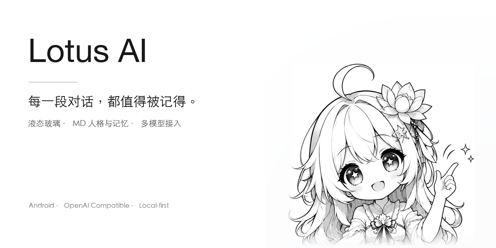
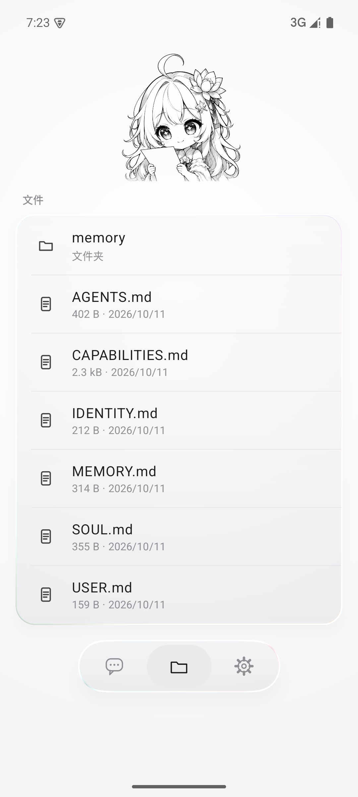
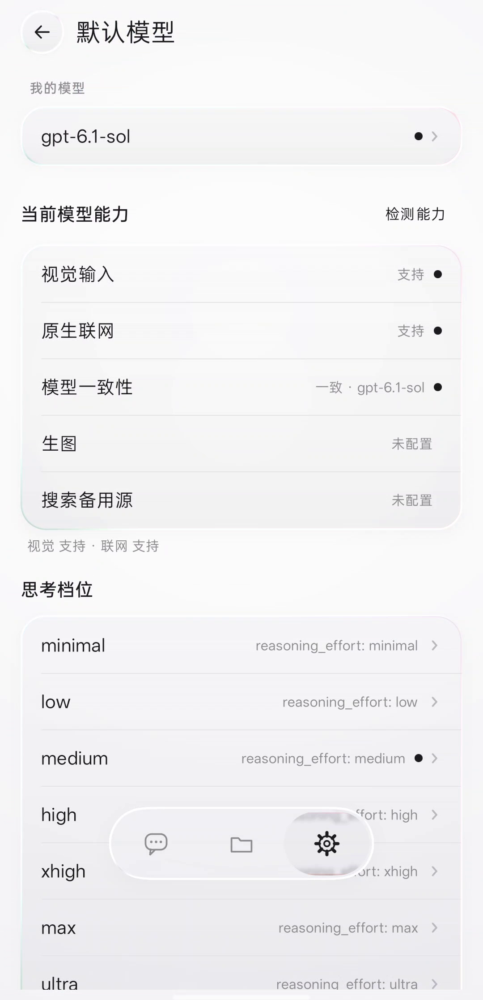

<p align="center">
  
</p>

<h1 align="center">Lotus AI</h1>

<p align="center">
  <strong>Models, memory, and device tools in one conversation surface.</strong>
</p>

<p align="center">
  Android · Liquid Glass · Markdown Memory · Local Tools
</p>

<p align="center">
  <a href="README.md">中文</a> · <b>English</b> ·
  <a href="../../releases/latest">Download APK</a> ·
  <a href="CHANGELOG.md">Changelog</a>
</p>

<p align="center">
  
  
  
  
</p>

---

Lotus AI is more than a chat client with a different skin.

It brings OpenAI-compatible model providers, editable personas and long-term memory, real reasoning streams, context accounting, image understanding and generation, and Android device tools into one Liquid Glass interface.

You connect the models. Your memory stays on-device. Every tool action must be explicitly triggered.

## Available now

| Capability | What you can do |
| --- | --- |
| Multi-provider chat | Configure multiple OpenAI-compatible providers with their own Base URL, API key, models, and context window |
| Streaming conversations | Read as the answer arrives, then stop, regenerate, edit, copy, quote, and manage conversation titles |
| Real reasoning | Read upstream `reasoning_content`, `reasoning_text`, and related fields while generating; collapse them afterward |
| Capability probes | Test image input, native web search, reasoning levels, and the model identity returned by the upstream |
| Markdown memory | Edit IDENTITY, SOUL, AGENTS, USER, MEMORY, and the archive directly |
| Vision and image generation | Send multiple images and generate images inside the conversation through a separate image model |
| Android system tools | Use Root or Shizuku for device information, app lists, foreground apps, settings, and allowlisted freeze/unfreeze actions |
| LinuxHub computer tools | Connect a local Ubuntu environment for terminal, headless desktop, screenshots, mouse, keyboard, and GUI apps |
| Tool activity | Inspect tool name, backend, duration, result, and failure reason, with success and failure kept separate |
| Context control | View real or clearly labelled estimated token usage, compress context, and keep the original transcript |
| Conversation management | Create, rename, archive, restore, delete, and auto-title conversations |
| On-device data | Store API keys, conversations, prompts, memory, avatars, and images in private app storage with encrypted backup |

## More than chat

### Memory you can open, edit, and move

Lotus AI does not hide memory in an opaque database. Persona, preferences, and durable facts are plain Markdown:

```text
filesDir/md/
├── IDENTITY.md      who the assistant is and how it refers to itself
├── SOUL.md          personality, tone, taste, and expression
├── AGENTS.md        rules and boundaries
├── USER.md          your name, preferences, and long-term profile
├── MEMORY.md        durable facts, agreements, and relationship context
├── CAPABILITIES.md  current capabilities and usage notes
└── memory/          detailed archive for projects, decisions, facts, and lessons
```

- Core Markdown files are read on every turn when prompts are enabled; no invisible vector database is required.
- Memory is merged **in place by topic**, not appended as a new snapshot every turn.
- If the model omits its hidden write marker, the client still records explicit names, languages, and preferences as a fallback.
- You can select “Remember this” in chat or edit any file directly in the Files workspace.
- Conversations, prompts, memory, and configuration all participate in password-encrypted backup.

### Model capabilities follow real results

Lotus AI uses the common OpenAI-compatible protocol and is not tied to one model vendor.

- Each provider keeps its own Base URL, key, model catalogue, and context window.
- Display names are separate from real upstream model IDs: the UI can show a friendly name while requests use the correct ID.
- Reasoning levels are verified against the upstream. If a model does not accept `max` or `ultra`, the UI does not pretend that it does.
- Native web search is sent only after the capability probe passes, so unsupported tool declarations cannot break a normal turn.
- Vision is tested with a real image. Image generation uses a separate multimodal service.
- The SSE parser handles text, reasoning, citations, usage, fragmented tool calls, and abnormal stream termination.

### Tools execute for real

Chat supports single-step function calling: the model asks for a tool, Lotus executes it once, feeds the structured result back, and then asks the model for the final answer. Missing or failed tools are reported as incomplete instead of being described as successful.

#### Root / Shizuku system tools

| Tool | Purpose |
| --- | --- |
| `system_device_status` | Device identity, Android version, model, and active privileged backend |
| `system_list_apps` | Query installed apps by package or app-name fragment |
| `system_foreground_app` | Current foreground package and activity |
| `system_read_setting` | Read-only access to `system`, `secure`, and `global` settings |
| `system_set_app_enabled` | Freeze or unfreeze an explicitly named non-critical app |

Root is preferred, with Shizuku as the compatibility backend. Authorization is always user-triggered and never requested during cold start. The model is not given arbitrary shell access; critical packages and invalid package names are rejected.

#### LinuxHub computer bridge

Enter the on-device token generated by LinuxHub to use these tools over `127.0.0.1:38473`:

- Container terminal
- Headless desktop start, status, and stop
- X11 screenshots
- Mouse, keyboard, and UTF-8 text input
- GUI application launch
- Shizuku status and system information

The token stays on-device, is never logged, and is never added to model context. Lotus performs a fresh handshake when returning to the foreground; computer tools appear only after both the health check and tool catalogue succeed.

### Context and cost stay visible

- Show real token usage when the server returns it, and label estimates clearly when it does not.
- Set a context window per model and inspect current occupancy and remaining space.
- Compressed requests send only “summary + newer messages”; the original transcript remains available.
- Optionally show model, user avatar, completion time, token count, and character count.
- Token usage from both rounds of a tool call is accumulated instead of counting only the final response.

### Liquid Glass is a complete material system

The interface is not a translucent background with a Gaussian blur on top:

- Low blur, edge refraction, chromatic dispersion, and highlights run through Home, Chat, menus, Settings, and dialogs.
- Controls scale and spring on press, with shared smooth / snappy / bouncy motion parameters.
- The composer grows with content, shrinks when cleared, and does not lose focus or dismiss the keyboard unexpectedly.
- Files, the in-app source reader, statistics, version logs, and system tools share the same visual language.

### Conversation essentials

- SSE streaming with readable output as it arrives.
- Expandable reasoning, tool records, and web sources.
- System text selection, copy, and select-all from long-press.
- Add images, video, and files directly from the composer.
- Open web sources in an in-app reader without leaving the conversation.
- Auto-generated titles, rename, archive, restore, and permanent deletion.
- First-run onboarding uses one real conversation to initialize your name, language, and expression preferences.

## Local-first by design

- No account and no telemetry.
- API keys, conversations, and memory live in private app storage.
- Encrypted backups include providers, conversations, Markdown, avatars, and images; a wrong password cannot overwrite existing data.
- The full source is open under Apache License 2.0.

## Screenshots

| Home | Chat |
| --- | --- |
|  |  |

| Persona and memory files | Model capability probe |
| --- | --- |
|  |  |

## Quick start

### Requirements

- Android 8.0 (API 28) or newer
- JDK 17
- Android SDK Platform 37

### Build

```bash
git clone https://github.com/xishanp/LotusAI.git
cd LotusAI
./gradlew :app:assembleDebug
adb install -r app/build/outputs/apk/debug/app-debug.apk
```

After first launch, enter the primary model's OpenAI-compatible `Base URL`, `API Key`, and model ID. Shizuku, Root, and LinuxHub are optional; the app works without them.

## Tech stack

| Layer | Choice |
| --- | --- |
| Language / UI | Kotlin 2.4.20 · Jetpack Compose BOM 2026.09.00 |
| Build | AGP 9.4.1 · Gradle 9.7.1 · JDK 17 |
| Platform | Android 8.0+ · `compileSdk 37` · `targetSdk 35` |
| Networking | `HttpURLConnection` + hand-written SSE parsing |
| Serialization | kotlinx.serialization |
| Liquid Glass | Kyant0 `backdrop` / `shapes` + Chris Banes `haze` |
| System tools | Root `su` + Shizuku UserService |
| Storage | Local JSON + plain-text Markdown |

## Project layout

```text
app/src/main/java/ai/lotus/app/
├── MainActivity.kt              entry, splash hand-off, and foreground reconnect
├── data/
│   ├── LlmApi.kt                OpenAI-compatible streaming chat and tool calls
│   ├── Prompts.kt               persona, memory, context, and hidden write protocol
│   ├── ModelCapabilities.kt     vision, web search, and model identity probes
│   ├── ThinkingTiers.kt         real reasoning-level probing
│   ├── ImageGen.kt              in-conversation image generation
│   └── BackupManager.kt         encrypted import and export
├── computer/                    LinuxHub local HTTP tool bridge
├── shizuku/                     Root / Shizuku backends and allowlisted tools
└── ui/
    ├── glass/                   Liquid Glass infrastructure
    ├── home/                    Home, composer, and overlays
    ├── chat/                    Chat, message actions, and generation animation
    ├── md/                      Markdown persona and memory workspace
    ├── reader/                  in-app source reader
    ├── computer/                Lotus Computer settings and tool panel
    ├── settings/                models, system tools, data, and about
    └── motion/                  shared motion parameters
```

## Versions and updates

Current version: `2026.10.24.1`

**Settings → About → Check for updates** reads the latest GitHub Release and compares it with the installed version. When an update exists, it opens the release page and never installs an APK silently.

See [CHANGELOG.md](CHANGELOG.md) for the full history, or open **Settings → About → Version log** in the app.

## Artwork

| Lotus | Thinking | Reading Markdown |
| --- | --- | --- |
|  |  |  |

| App icon | Home design sheet |
| --- | --- |
|  |  |

## License

Released under the [Apache License 2.0](LICENSE). Third-party dependencies and assets are documented in [THIRD_PARTY_NOTICES.md](THIRD_PARTY_NOTICES.md).

## Credits

Liquid Glass refraction, dispersion, blur, and highlights build on these open-source projects:

| Project | Used for | License |
| --- | --- | --- |
| [Kyant0/AndroidLiquidGlass](https://github.com/Kyant0/AndroidLiquidGlass) | refraction, dispersion, highlights, and shape foundation | Apache-2.0 |
| [chrisbanes/haze](https://github.com/chrisbanes/haze) | blur and material foundation | Apache-2.0 |
| [RikkaApps/Shizuku](https://github.com/RikkaApps/Shizuku) | privileged Binder and UserService | Apache-2.0 |

Thanks also to every open-source author making expression on Android better.
