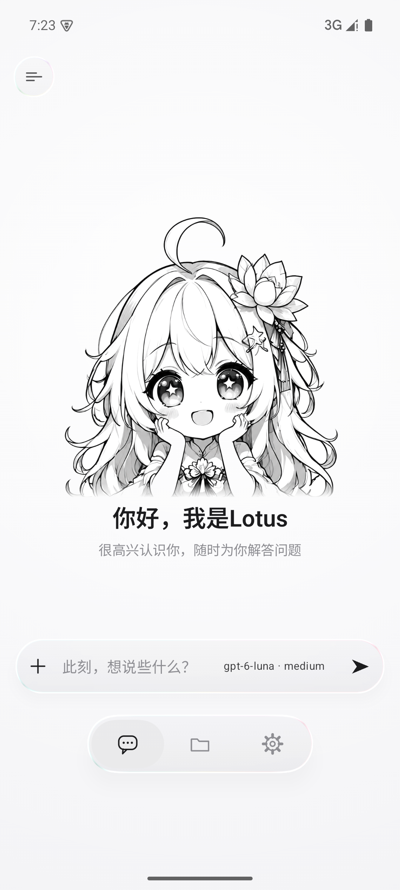
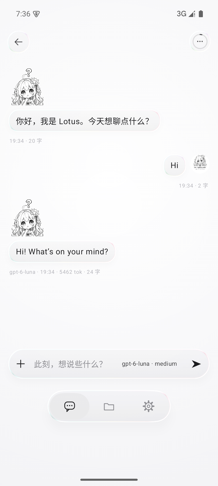
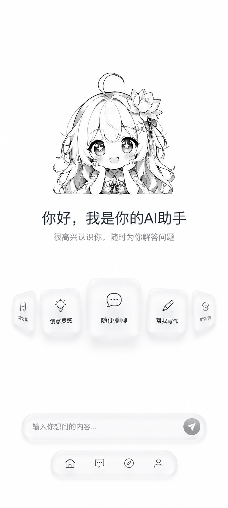

<p align="center">
  
</p>

<h1 align="center">Lotus AI</h1>

<p align="center">
  <strong>Let AI get work done on your phone and Linux host.</strong>
</p>

<p align="center">
  Local AI workstation · Android control · Linux desktop and terminal · Multi-provider chat
</p>

<p align="center">
  <a href="README.md">中文</a> · <b>English</b> ·
  <a href="../../releases/latest">Download signed APK</a> ·
  <a href="CHANGELOG.md">Changelog</a>
</p>

<p align="center">
  
  
  
  
</p>

---

Lotus AI is not a chat shell. It turns your Android phone and local Linux host into execution targets for your models.

You describe the task. The model calls the tools you authorize: read device state, manage allowlisted apps, run container commands, start a headless desktop, capture the screen, move the mouse, type text, and bring real results back into the conversation.

> Work runs on your own devices, with no cloud virtual machine. Root, Shizuku, and LinuxHub are optional; once connected, the model can only use the tools you have explicitly authorized.

## Two execution targets

### 1. Android device

A privileged backend uses **Root first, Shizuku as fallback** with a fixed allowlist:

| Tool | What it does |
| --- | --- |
| Device status | Android version, model, UID, and active privileged backend |
| App list | Query and filter installed applications |
| Foreground app | Read the current package and activity |
| System settings | Read-only access to `system`, `secure`, and `global` settings |
| App switch | Freeze or unfreeze an explicitly named non-critical app |

- Shizuku runs in a dedicated UserService process and requests authorization only from an explicit user action.
- Arbitrary shell access is not exposed. Critical packages, invalid package names, and out-of-range arguments are rejected.
- Root and Shizuku status, identity, and connection results are shown live in Settings.

### 2. Local Linux host

Enter the on-device token generated by LinuxHub to connect to Ubuntu over `127.0.0.1:38473`:

| Capability | Details |
| --- | --- |
| Terminal | Run container commands and return stdout, stderr, exit code, and duration |
| Headless desktop | Start, inspect, and stop an X11 + XFCE desktop |
| Screenshot | Capture the X11 root window as PNG |
| Mouse | Move, click, drag, and scroll |
| Keyboard and text | Key combinations, keys, and UTF-8 text input |
| GUI apps | Launch applications inside the desktop |
| System information | Shizuku status, container, and host details |

The token stays on-device, is never logged, and is never added to model context. Lotus performs a fresh handshake when returning to the foreground; computer tools appear only after both the health check and tool catalogue succeed.

## Tool calls execute for real

Chat supports streaming function calling:

```text
User asks for a task
  ↓
The model selects a tool and generates arguments
  ↓
Lotus calls Root / Shizuku or LinuxHub
  ↓
The real result is sent back to the model
  ↓
The model answers from that result
```

- Tool argument fragments are assembled from the stream, not treated as a single payload.
- At most one tool is executed per turn. The result goes back to the model, then the turn ends without an infinite Agent loop.
- Tool name, backend, duration, and result are visible during generation and remain available afterward.
- Missing or failed tools are marked incomplete; a failed action cannot be described as successful.
- When web search conflicts with local tools, Lotus preserves local tools first and downgrades automatically instead of silently removing authorized capabilities.

### Things you can ask

- “Read the current foreground app.”
- “List installed apps whose package name contains chrome.”
- “Freeze this non-critical app, then unfreeze it later.”
- “Start the Ubuntu headless desktop and take a screenshot.”
- “Run `pwd` and `uname -a` in the container.”
- “Launch a GUI app and type Chinese text into its input field.”
- “Remember that I like tea and keep answers short.”
- “Turn this reference image into a new image.”

## More than tools

### Multiple models with real capability checks

- Configure multiple OpenAI-compatible providers with independent Base URL, API key, models, and context window.
- Display names are separate from real upstream model IDs: the UI can show a friendly name while requests use the correct ID.
- Stream text, reasoning, citations, usage, tool calls, and abnormal termination states.
- Verify reasoning levels against the upstream. If a model does not accept `max` or `ultra`, the UI does not pretend that it does.
- Probe image input, native web search, and the model identity returned by the relay.
- Includes vision, a separate image-generation model, regenerate, edit, copy, quote, and stop.

### Markdown persona and memory

```text
filesDir/md/
├── IDENTITY.md      who the assistant is and how it refers to itself
├── SOUL.md          personality, tone, taste, and expression
├── AGENTS.md        rules and boundaries
├── USER.md          your name, preferences, and long-term profile
├── MEMORY.md        durable facts, agreements, and relationship context
├── CAPABILITIES.md  current capabilities and usage notes
└── memory/          project, decision, and fact archive
```

Core files are read every turn, and memory is merged in place by topic instead of accumulating duplicate snapshots. If the model omits its hidden write marker, the client still records explicit names, languages, and preferences as a fallback. Every file can also be edited directly.

### Context and cost

- Show real token usage when the server returns it; label estimates clearly when it does not.
- Set a context window per model.
- Compressed requests send only “summary + newer messages”; the original transcript remains available.
- Accumulate token use across both rounds of a tool call.
- Optionally show model, avatar, completion time, token count, and character count.

### Liquid Glass interface

Home, Chat, menus, Settings, Files, the source reader, and tool panels share one material and motion system:

- Low blur, edge refraction, chromatic dispersion, and highlights instead of a plain Gaussian blur.
- Spring-based press and release with shared smooth / snappy / bouncy parameters.
- The composer grows with content and shrinks when cleared.
- Conversations support auto-titles, rename, archive, restore, and permanent deletion.
- Web sources open in an in-app reader without leaving the conversation.

## Local-first

- No account and no telemetry.
- API keys, conversations, prompts, memory, avatars, and images live in private app storage.
- Encrypted backups include providers, conversations, Markdown, avatars, and images; a wrong password cannot overwrite existing data.
- The full source is open under Apache License 2.0.

## Screenshots

| Home | Chat |
| --- | --- |
|  |  |

| Persona and memory files | Model capability probe |
| --- | --- |
|  |  |

## Quick start

### Install

Download the signed APK from [Releases](../../releases/latest). On first launch, enter the primary model's OpenAI-compatible `Base URL`, `API Key`, and model ID.

Root, Shizuku, and LinuxHub are all optional:

- To use Android system tools, connect Root or Shizuku in **Settings → System tools**.
- To use the local Linux host, copy the token from LinuxHub, then open **Settings → Lotus Computer**, save the token, and test the connection.

### Build

JDK 17 and Android SDK Platform 37 are required.

```bash
git clone https://github.com/xishanp/LotusAI.git
cd LotusAI
./gradlew :app:assembleRelease
adb install -r app/build/outputs/apk/release/app-release.apk
```

## Tech stack

| Layer | Choice |
| --- | --- |
| Language / UI | Kotlin 2.4.20 · Jetpack Compose BOM 2026.09.00 |
| Build | AGP 9.4.1 · Gradle 9.7.1 · JDK 17 |
| Platform | Android 8.0+ · `compileSdk 37` · `targetSdk 35` |
| Networking | `HttpURLConnection` + hand-written SSE parsing |
| Liquid Glass | Kyant0 `backdrop` / `shapes` + Chris Banes `haze` |
| System tools | Root `su` + Shizuku UserService |
| Local computer | LinuxHub HTTP Agent Bridge |
| Storage | Local JSON + plain-text Markdown |

## Project layout

```text
app/src/main/java/ai/lotus/app/
├── MainActivity.kt              entry, splash, and foreground reconnect
├── data/
│   ├── LlmApi.kt                streaming chat, reasoning, and function calling
│   ├── Prompts.kt               persona, memory, and hidden write protocol
│   ├── ModelCapabilities.kt     vision, web search, and identity probes
│   ├── ThinkingTiers.kt         real reasoning-level probing
│   ├── ImageGen.kt              in-conversation image generation
│   └── BackupManager.kt         encrypted import and export
├── computer/                    LinuxHub local HTTP tool bridge
├── shizuku/                     Root / Shizuku backends and allowlisted tools
└── ui/
    ├── glass/                   Liquid Glass infrastructure
    ├── chat/                    chat, message actions, and generation animation
    ├── md/                      Markdown persona and memory workspace
    ├── computer/                Lotus Computer settings and tool panel
    ├── settings/                models, system tools, data, and about
    └── motion/                  shared motion parameters
```

## Version

Current version: `2026.10.24.1`

**Settings → About → Check for updates** reads GitHub Releases. See [CHANGELOG.md](CHANGELOG.md) for the full history or **Settings → About → Version log** inside the app.

## Artwork

| Lotus | Thinking | Reading Markdown |
| --- | --- | --- |
|  |  |  |

| App icon | Home design sheet |
| --- | --- |
|  |  |

## License

Released under the [Apache License 2.0](LICENSE). Third-party dependencies and assets are documented in [THIRD_PARTY_NOTICES.md](THIRD_PARTY_NOTICES.md).

## Credits

| Project | Used for | License |
| --- | --- | --- |
| [Kyant0/AndroidLiquidGlass](https://github.com/Kyant0/AndroidLiquidGlass) | refraction, dispersion, highlights, and shape foundation | Apache-2.0 |
| [chrisbanes/haze](https://github.com/chrisbanes/haze) | blur and material foundation | Apache-2.0 |
| [RikkaApps/Shizuku](https://github.com/RikkaApps/Shizuku) | privileged Binder and UserService | Apache-2.0 |
