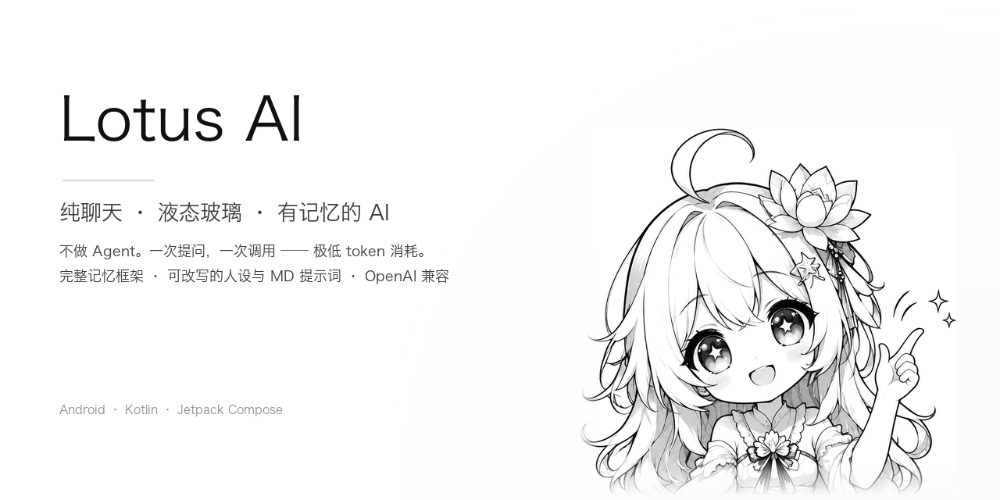
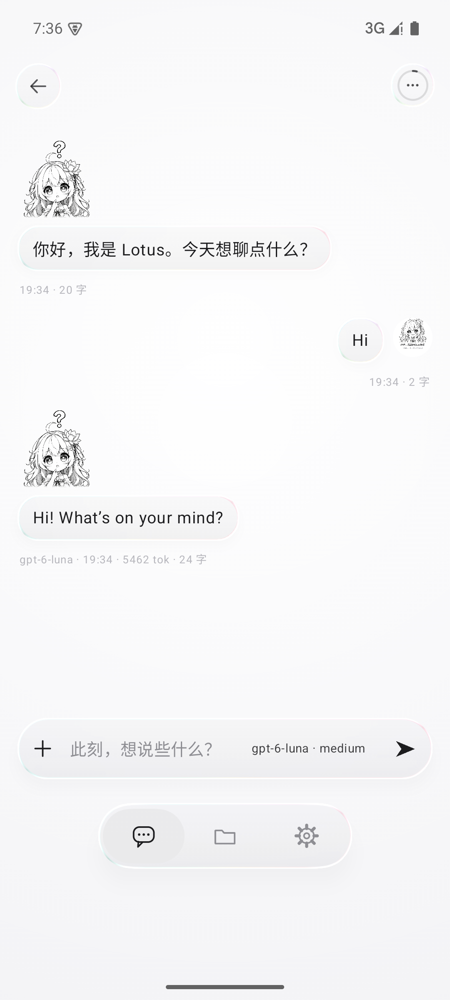
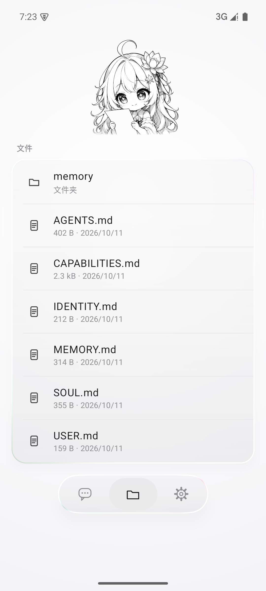
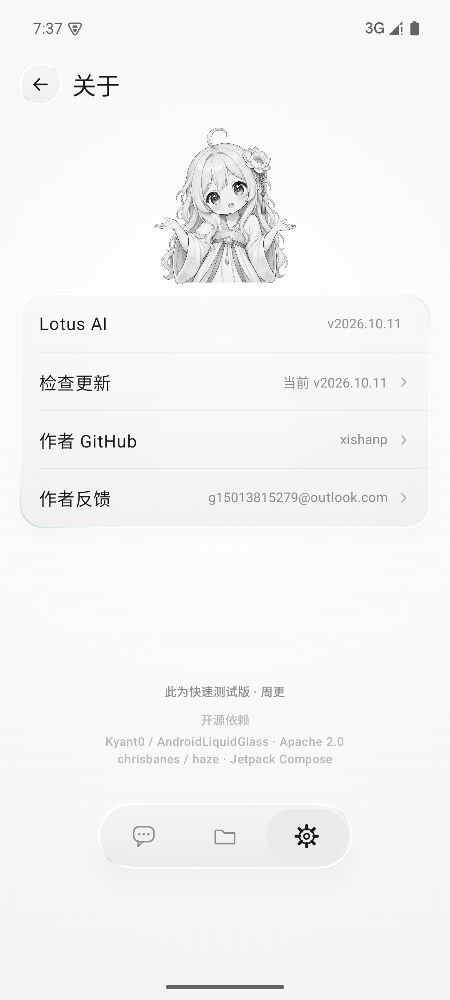

<p align="center">
  
</p>

<h3 align="center">Pure chat · Liquid glass · An AI that remembers</h3>

<p align="center">
  <a href="README.md">中文</a> · <b>English</b>
</p>

---

**Lotus AI** is a pure chat app for Android. No agent, no tool chain — it does one thing well:
a conversation. **One question = one model call**, so token usage stays minimal and answers come back
fast, while keeping a complete memory framework and a persona you can rewrite.

## Why not "yet another agent"

With the same model, a chat app can cost a fraction of an agent — the difference is not the model,
it is **what you stuff into the request**:

| | Plain chat (Lotus) | Agent / Codex / OpenClaw style |
| --- | --- | --- |
| One question | **one call** | one call × many tool loops |
| System prompt | persona + memory | persona + memory + docs for dozens of tools |
| Context | what you actually said | tool output, file contents, logs |
| Feel | fast, cheap | slow, expensive |

Lotus stays in the left column. **No skills, no tools, no MCP** — that is exactly where the right
column's cost comes from.

## Liquid glass, everywhere

- One recipe for every glass surface: **light blur + edge refraction + chromatic dispersion + a white
  inner rim + a soft outer shadow**, on a pure white background with no colour.
- No second glass inside a glass: nested buttons are invisible at rest and only refract while pressed.
- Every control has real feedback — press scale, edge refraction, and neighbouring glass leans along.

## Memory & persona: plain Markdown you can edit

Both live as plain text files, editable from the "Files" tab:

```
filesDir/md/
├── IDENTITY.md   who I am        ← injected every turn
├── SOUL.md       how I speak     ← injected every turn
├── AGENTS.md     rules & limits  ← injected every turn
├── USER.md       about you       ← injected every turn
├── MEMORY.md     long-term memory← injected every turn
└── memory/       archive (not injected)
    facts · decisions · lessons · projects · references · tasks · temporary
```

- **Automatic memory**: the model writes a single `<!--memo: your name is K -->` line, the client
  strips it from the same reply and appends it to `MEMORY.md` — no second request, no extra tokens.
- **Manual memory**: `⋯ → Remember this` turns the current conversation into a few long-term lines.
- **Auto title**: each conversation gets a generated topic after its first reply.

## Models

- **OpenAI-compatible protocol**; provider, base URL and API key are entirely yours to fill in —
  nothing is preconfigured.
- Thinking tiers map to each model's real capability (`medium` / `high` / `xhigh` … up to `max` / `ultra`).
- Web search is opt-in: it only adds `tools:[{"type":"web_search"}]` to the body — the upstream does
  the searching, and the client still makes **exactly one call**.

## Screenshots

| Home | Chat |
| --- | --- |
|  |  |

| Files (persona & memory) | About |
| --- | --- |
|  |  |

## Open-source dependencies

Liquid glass is not something a single `blur()` can fake — thanks to the upstream projects:

| Dependency | Purpose | License |
| --- | --- | --- |
| [Kyant0/AndroidLiquidGlass](https://github.com/Kyant0/AndroidLiquidGlass) (`io.github.kyant0:backdrop` / `shapes`) | refraction / dispersion / blur foundation | Apache-2.0 |
| [chrisbanes/haze](https://github.com/chrisbanes/haze) | blur foundation | Apache-2.0 |

## Download

Grab the APK from [Releases](../../releases). This is a **fast-test build** (debug signed).

In the app: `Settings → About → Check for updates` reads the latest Release tag of this repository.

---

**Fast build, updated weekly.**
