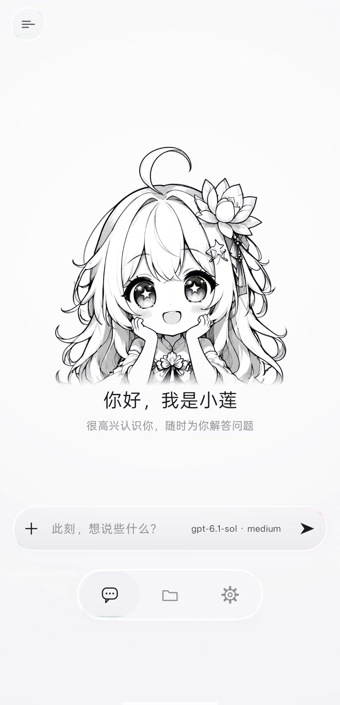
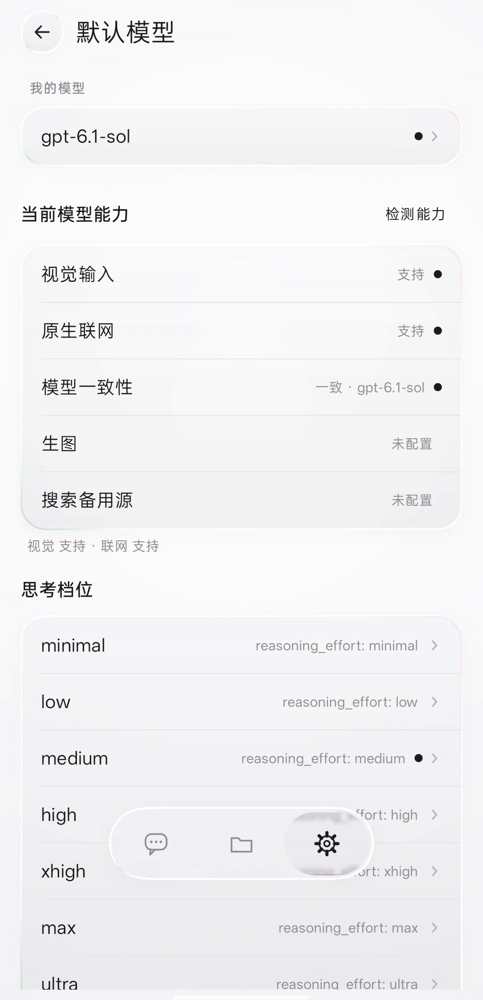
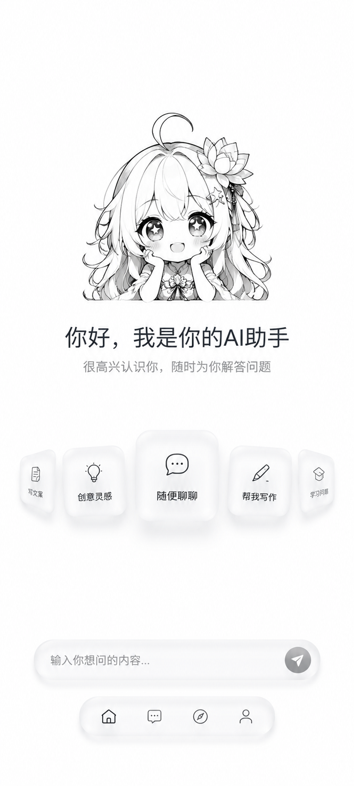

<p align="center">
  
</p>

<h1 align="center">Lotus AI</h1>

<p align="center">
  <strong>When conversation remembers, glass begins to breathe.</strong>
</p>

<p align="center">
  Android · Liquid Glass everywhere · Markdown persona and memory · OpenAI-compatible
</p>

<p align="center">
  <a href="README.md">中文</a> · <b>English</b> ·
  <a href="../../releases/latest">Download APK</a> ·
  <a href="CHANGELOG.md">Changelog</a>
</p>

<p align="center">
  
  
  
  
</p>

---

## About Lotus AI

Lotus AI is an AI conversation space designed for Android.

It brings together the things that shape everyday conversation: a restrained Liquid Glass interface, a stable personality you can rewrite, Markdown memory you can maintain for years, transparent context costs, and model access without vendor lock-in.

You choose the model. You define the persona. Your memories stay on your device. There are no crowded toolbars and no hidden context consumption.

## Why Lotus AI

### Liquid Glass, not a blurred layer

Lotus AI's glass is a material system that runs through the entire interface, not a translucent background with a blur stacked on top.

- **Light blur, edge refraction and chromatic dispersion** remain visible even on a white canvas.
- Controls scale on press, lean toward the finger and gently interact with nearby glass.
- Panels, the composer, menus, dialogs and the reader share one visual language.
- The interface stays quiet at rest, then releases refraction, stretching and soft highlights only when touched.

Glass should help content breathe, not take attention away from it.

### A persona and memory system you can actually maintain

Lotus AI does not hide memory in an opaque database. Persona, preferences and long-term memory are Markdown files that you can open and edit directly:

```text
filesDir/md/
├── IDENTITY.md      who the assistant is and how it refers to itself
├── SOUL.md          personality, tone, taste and expression
├── AGENTS.md        rules and boundaries
├── USER.md          your name, preferences and long-term profile
├── MEMORY.md        durable facts, agreements and relationship context
├── CAPABILITIES.md  current capabilities and usage notes
└── memory/          detailed archive for projects, decisions, facts and lessons
```

When prompts and memory are enabled, `IDENTITY / SOUL / AGENTS / USER / MEMORY` are read in full on every turn. `memory/` remains a detailed archive instead of being forced into every request.

The model can write hidden markers inside the same response. The client extracts them and merges each entry **in place by topic** into the correct file instead of appending snapshot after snapshot. You can also choose “Remember this” from a conversation, or edit any file yourself from the Files workspace.

A persona is not a one-time setting. It can be tuned through conversation, cleared, backed up and moved to another device.

### Context you can see and control

Lotus AI distinguishes between **real token usage returned by the server** and clearly labelled estimates when the upstream does not return usage. It never presents an estimate as a billed result.

- Set a context window for every model provider.
- See current context occupancy and remaining space per conversation.
- Compress context without deleting the transcript: the summary covers processed messages, while later requests send the summary plus newer messages.
- Optionally show model, avatar, completion time, token count and character count beneath each reply.
- Each turn sends the active persona, memory, summary and conversation messages that still fit the context, rather than unrelated payloads.

### Your models, with capabilities based on real results

Lotus AI uses the common OpenAI-compatible protocol and does not lock you to one model vendor.

- Configure any number of providers, each with its own Base URL, API key, model list and context window.
- Load the model catalogue through `/models` and run a connection test.
- Chat through `/chat/completions` with streaming and real upstream reasoning fields such as `reasoning_content`, `reasoning` and `reasoning_text`.
- Reasoning levels are not decorative. The client verifies each candidate level against the upstream and only exposes the levels the model actually accepts.
- Probe image input, native web search, and whether the relay's reported model identity matches the selected model.
- Connect image generation through a separate multimodal endpoint. Generation progress appears inside the conversation and the finished image lands in the message.
- Native web search is enabled only after the model passes a real capability check, so unsupported tool declarations cannot break an ordinary chat turn.

### The details a conversation deserves

- Server-sent streaming, rendered as soon as the first token arrives.
- Real reasoning and tool activity expand while answering and collapse afterward; tap Lotus's avatar to inspect them again.
- Message actions include copy, quote, edit-and-resend, regenerate and retract.
- Long-press text for system selection, copy and select-all.
- Web sources open in an in-app reader without leaving the conversation.
- Add images, videos and files directly from the composer.
- Conversations receive automatic titles and support rename, archive, restore and permanent deletion.
- First-run onboarding connects the primary model and then completes a real conversation to initialize your name, language and expression preferences.

### Local-first, portable by design

- No account and no telemetry.
- API keys and conversation data live in the app's private storage.
- Export conversations, providers, Markdown files, avatars and images as password-encrypted backup. A wrong password cannot overwrite existing data.
- The complete source is open under the Apache License 2.0.

## Screenshots

| Home | Chat |
| --- | --- |
|  |  |

| Persona and memory files | Model capability probe |
| --- | --- |
|  |  |

## Quick start

### Requirements

- Android 8.0 (API 28) or newer
- JDK 17
- Android SDK Platform 37

### Build

```bash
git clone https://github.com/xishanp/LotusAI.git
cd LotusAI
./gradlew :app:assembleDebug
```

Install the debug build:

```bash
adb install -r app/build/outputs/apk/debug/app-debug.apk
```

After first launch, follow onboarding and enter the OpenAI-compatible `Base URL` (usually ending in `/v1`), `API Key` and model id. Once the primary model connects, you can start chatting.

## Tech stack

| Layer | Choice |
| --- | --- |
| Language / UI | Kotlin 2.4.20 · Jetpack Compose BOM 2026.09.00 |
| Build | AGP 9.4.1 · Gradle 9.7.1 · JDK 17 |
| Platform | Android 8.0+ · `compileSdk 37` · `targetSdk 35` |
| Networking | `HttpURLConnection` + hand-written SSE parsing |
| Serialization | kotlinx.serialization |
| Liquid Glass | Kyant0 `backdrop` / `shapes` + Chris Banes `haze` |
| Storage | Local JSON + plain-text Markdown |

## Project layout

```text
app/src/main/java/ai/lotus/app/
├── MainActivity.kt              app entry and system splash hand-off
├── data/
│   ├── LlmApi.kt                OpenAI-compatible streaming chat
│   ├── Provider.kt              multi-provider setup and selection persistence
│   ├── Prompts.kt               persona, memory, context and hidden write protocol
│   ├── ModelCapabilities.kt     vision, web search and model identity probes
│   ├── ThinkingTiers.kt         real reasoning-level probing
│   ├── ImageGen.kt              in-conversation image generation
│   ├── BackupManager.kt         encrypted import and export
│   └── Changelog.kt             in-app release notes
└── ui/
    ├── LotusApp.kt              app shell and fixed layers
    ├── glass/                   Liquid Glass infrastructure
    ├── home/                    home, composer and overlays
    ├── chat/                    chat, message actions and generation animation
    ├── onboarding/              first-run onboarding
    ├── md/                      Markdown persona and memory workspace
    ├── reader/                  in-app source reader
    ├── settings/                models, memory, data and about
    └── nav/                     bottom navigation
```

## Versions and updates

Current version: `2026.10.19`

**Settings → About → Check for updates** reads the latest GitHub Release and compares it with the installed version. When a new version is available, it opens the release page and never installs an APK silently in the background.

See [CHANGELOG.md](CHANGELOG.md) for the complete release history, or open **Settings → About → Version log** inside the app.

## Artwork

| Lotus | Thinking | Reading Markdown |
| --- | --- | --- |
|  |  |  |

| App icon | Home design sheet |
| --- | --- |
|  |  |

## License

Released under the [Apache License 2.0](LICENSE). Third-party dependencies and assets are documented in [THIRD_PARTY_NOTICES.md](THIRD_PARTY_NOTICES.md).

## Credits

Liquid Glass refraction, dispersion, blur and highlights build on these excellent open-source projects:

| Project | Used for | License |
| --- | --- | --- |
| [Kyant0/AndroidLiquidGlass](https://github.com/Kyant0/AndroidLiquidGlass) | refraction, dispersion, highlights and shape foundation | Apache-2.0 |
| [chrisbanes/haze](https://github.com/chrisbanes/haze) | blur and material foundation | Apache-2.0 |

Thanks also to every open-source author making expression on Android better.
