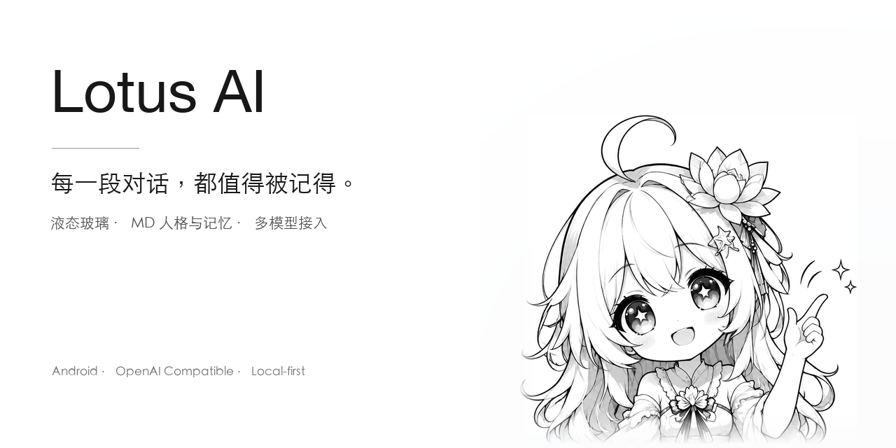
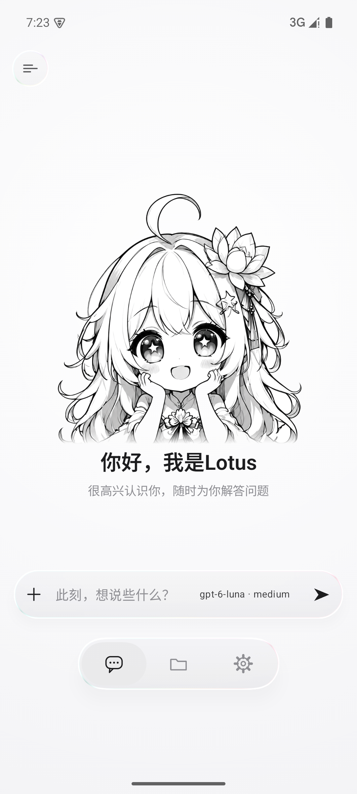
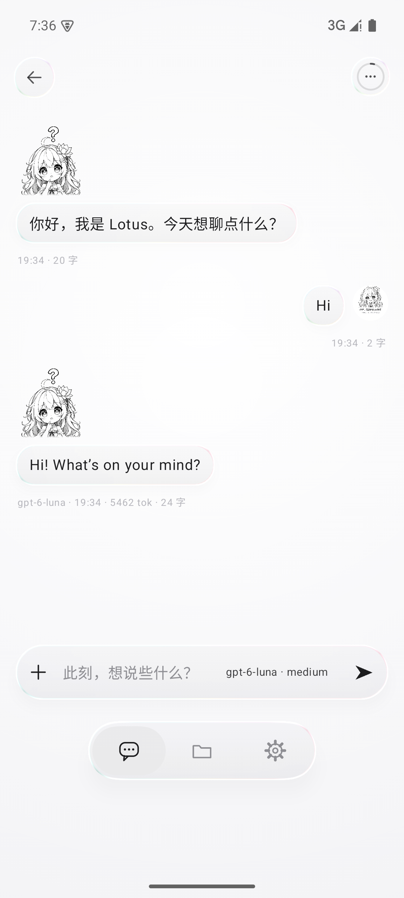
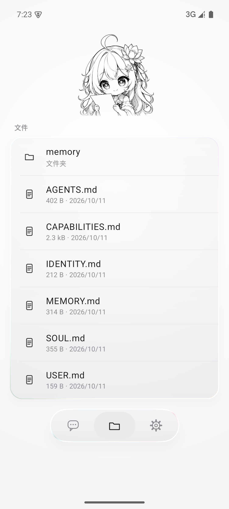
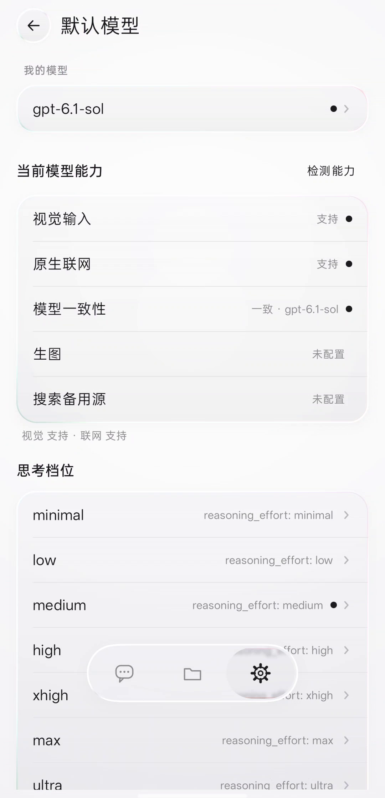
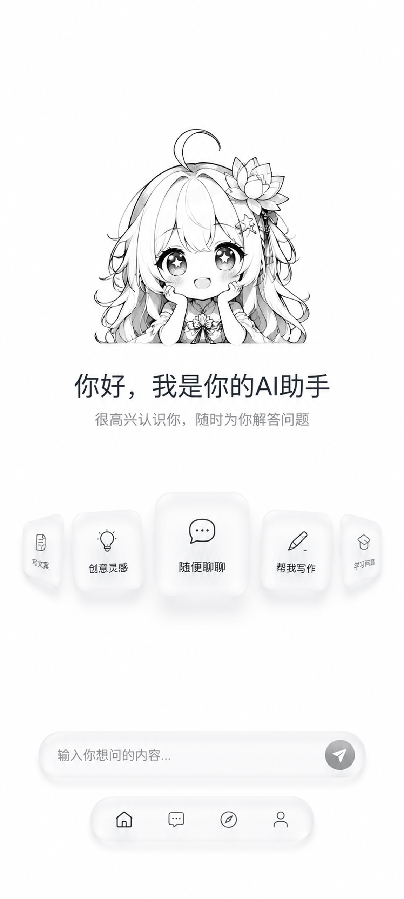

<p align="center">
  
</p>

<h1 align="center">Lotus AI</h1>

<p align="center">
  <strong>让 AI 在你的手机和 Linux 主机上真正干活。</strong>
</p>

<p align="center">
  本地 AI 工作站 · Android 系统控制 · Linux 桌面与终端 · 多模型对话
</p>

<p align="center">
  <b>中文</b> · <a href="README.en.md">English</a> ·
  <a href="../../releases/latest">下载签名 APK</a> ·
  <a href="CHANGELOG.md">更新日志</a>
</p>

<p align="center">
  
  
  
  
</p>

---

Lotus AI 不是聊天壳。它把你的 Android 手机和本机 Linux 主机变成模型的执行端。

你说任务，模型调用你授权的工具：读取设备状态、管理白名单应用、执行容器命令、启动无头桌面、截图、移动鼠标、输入键盘与文字，再把真实结果带回对话。

> 任务在你的设备上执行，不需要云端虚拟机。Root / Shizuku 和 LinuxHub 都是可选能力；开启后，模型只能使用你已经连接并授权的工具。

## 两个执行端

### 1. Android 手机

通过 **Root 优先、Shizuku 兜底** 的特权后端执行固定白名单工具：

| 工具 | 能做什么 |
| --- | --- |
| 设备状态 | Android 版本、机型、UID 与当前特权后端 |
| 应用列表 | 查询、筛选已安装应用 |
| 前台应用 | 读取当前应用与 Activity |
| 系统设置 | 只读访问 `system`、`secure`、`global` 设置 |
| 应用开关 | 冻结或解冻用户明确指定的非关键应用 |

- Shizuku 使用独立 UserService 进程，授权只由用户主动触发。
- 不开放任意 shell；关键系统应用、非法包名和越界参数会直接拒绝。
- Root 与 Shizuku 状态、身份和连接结果都在设置中实时显示。

### 2. 本机 Linux 电脑主机

在 Lotus 中填入 LinuxHub 生成的本机 Token，通过 `127.0.0.1:38473` 连接 Ubuntu 环境：

| 能力 | 说明 |
| --- | --- |
| 终端 | 在容器中执行命令并取回 stdout、stderr、退出码与耗时 |
| 无头桌面 | 启动、查询、停止 X11 + XFCE 桌面 |
| 截图 | 捕获 X11 根窗口并返回 PNG |
| 鼠标 | 移动、点击、拖动、滚轮 |
| 键盘与文字 | 组合键、按键和 UTF-8 文本输入 |
| 图形应用 | 从桌面环境启动应用 |
| 系统信息 | Shizuku 状态、容器与主机信息 |

Token 只保存在本机，不写日志、不进入模型上下文。Lotus 回到前台会重新握手；只有健康检查和工具目录都成功，电脑工具才会出现在聊天中。

## 工具调用是真的

聊天支持流式 function calling：

```text
用户提出任务
  ↓
模型选择工具并生成参数
  ↓
Lotus 调用 Root / Shizuku 或 LinuxHub
  ↓
真实结果回填给模型
  ↓
模型基于结果完成回答
```

- 工具参数支持流式分片拼接，不只处理一次性返回。
- 一轮最多执行一次工具，结果回填后直接回答，不进入无限 Agent 循环。
- 回答中实时显示工具名、后端、耗时与结果；完成后可复查工具记录。
- 工具不可用或执行失败时明确标记“未完成”，不允许把失败说成成功。
- 联网搜索与本机工具冲突时优先保留本机工具，再自动降级，不会静默删除已授权能力。

### 可以直接这样用

- “读取当前前台应用。”
- “列出已安装应用里包名带 chrome 的。”
- “冻结这个非关键应用，稍后再解冻。”
- “启动 Ubuntu 无头桌面，截一张图。”
- “在容器里运行 `pwd` 和 `uname -a`。”
- “打开图形应用，然后在输入框里写一段中文。”
- “记住我喜欢喝茶，以后回答简短一点。”
- “把这张参考图改成新的图片。”

## 不只是工具

### 多模型与真实能力

- 配置多个 OpenAI 兼容提供方，分别保存 Base URL、API Key、模型与上下文窗口。
- 模型显示名与真实上游 ID 分离：界面能显示中文名，请求仍使用真实模型 ID。
- 流式读取文本、推理、引用、usage、工具调用和异常结束状态。
- 思考档位逐级向模型验证；上游不接受 `max` 或 `ultra` 时不会假装支持。
- 实测图片输入、原生联网与上游回显模型名。
- 图片理解、独立生图模型、重新回答、编辑、复制、引用与一键停止。

### Markdown 人格与记忆

```text
filesDir/md/
├── IDENTITY.md      我是谁、如何自称
├── SOUL.md          性格、语气、审美与表达方式
├── AGENTS.md        行为规则与边界
├── USER.md          称呼、偏好与长期画像
├── MEMORY.md        长期事实、约定与关系背景
├── CAPABILITIES.md  当前能力与使用说明
└── memory/          项目、决定与事实档案
```

核心文件按轮读取；记忆按主题原位合并，不会不断追加重复快照。模型漏写隐藏标记时，客户端仍会从明确指令中兜底记录；你也可以随时在文件页直接修改。

### 上下文与成本

- 服务端返回真实 token 时显示真实值，否则明确标为估算。
- 每个模型可单独设置上下文窗口。
- 压缩后的请求只发送“摘要 + 新消息”，原对话仍保留。
- 工具调用涉及的两轮 token 会累计显示。
- 可选显示模型、头像、完成时间、token 数和文字数。

### 液态玻璃界面

主页、聊天、菜单、设置、文件页、来源阅读器和工具面板共用一套材质与动效：

- 低模糊、边缘折射、色散和高光，而不是单纯高斯模糊。
- 按键按压缩放与回弹，统一使用 smooth / snappy / bouncy 参数。
- 输入框随内容增长并在清空后收回。
- 会话支持自动标题、重命名、归档、恢复与永久删除。
- 联网来源在应用内打开，不打断当前对话。

## 本地优先

- 不需要账号，没有遥测。
- API Key、对话、提示词、记忆、头像与图片保存在应用私有目录。
- 加密备份包含模型配置、会话、Markdown、头像和图片；错误密码不会覆盖现有数据。
- 完整源码使用 Apache License 2.0 开源。

## 界面预览

| 主页 | 对话 |
| --- | --- |
|  |  |

| 人格与记忆文件 | 模型能力检测 |
| --- | --- |
|  |  |

## 快速开始

### 安装

从 [Releases](../../releases/latest) 下载正式签名 APK。首次启动后填写主模型的 OpenAI 兼容 `Base URL`、`API Key` 和模型 ID。

Root、Shizuku、LinuxHub 全部可选：

- 需要 Android 系统工具时，在 `设置 → 系统工具` 中连接 Root 或 Shizuku。
- 需要本机 Linux 电脑时，在 LinuxHub 复制 Token，再进入 `设置 → Lotus的电脑` 保存并检测连接。

### 构建

需要 JDK 17 与 Android SDK Platform 37。

```bash
git clone https://github.com/xishanp/LotusAI.git
cd LotusAI
./gradlew :app:assembleRelease
adb install -r app/build/outputs/apk/release/app-release.apk
```

## 技术栈

| 层 | 选型 |
| --- | --- |
| 语言 / UI | Kotlin 2.4.20 · Jetpack Compose BOM 2026.09.00 |
| 构建 | AGP 9.4.1 · Gradle 9.7.1 · JDK 17 |
| 系统范围 | Android 8.0+ · `compileSdk 37` · `targetSdk 35` |
| 网络 | `HttpURLConnection` + 手写 SSE 解析 |
| 液态玻璃 | Kyant0 `backdrop` / `shapes` + Chris Banes `haze` |
| 系统工具 | Root `su` + Shizuku UserService |
| 本机电脑 | LinuxHub HTTP Agent Bridge |
| 存储 | 本机 JSON + 纯文本 Markdown |

## 项目结构

```text
app/src/main/java/ai/lotus/app/
├── MainActivity.kt              应用入口、启动页与前台重连
├── data/
│   ├── LlmApi.kt                流式聊天、推理与 function calling
│   ├── Prompts.kt               人格、记忆与隐藏写入协议
│   ├── ModelCapabilities.kt     视觉、联网与模型一致性探测
│   ├── ThinkingTiers.kt         真实思考档位探测
│   ├── ImageGen.kt              对话内图片生成
│   └── BackupManager.kt         加密导入与导出
├── computer/                    LinuxHub 本机 HTTP 工具桥
├── shizuku/                     Root / Shizuku 后端与白名单工具
└── ui/
    ├── glass/                   液态玻璃基础设施
    ├── chat/                    对话、消息动作与生成动画
    ├── md/                      Markdown 人格与记忆工作区
    ├── computer/                Lotus的电脑设置与工具面板
    ├── settings/                模型、系统工具、数据与关于
    └── motion/                  全局动效参数
```

## 版本

当前版本：`2026.10.24.1`

`设置 → 关于 → 检查更新` 会读取 GitHub Releases。完整记录见 [CHANGELOG.md](CHANGELOG.md)，也可以在应用内通过 `设置 → 关于 → 版本日志` 查看。

## 设计素材

| 小莲 | 思考 | 阅读 Markdown |
| --- | --- | --- |
|  |  |  |

| 应用图标 | 首页设计稿 |
| --- | --- |
|  |  |

## 开源许可

本项目以 [Apache License 2.0](LICENSE) 开源。第三方依赖与素材说明见 [THIRD_PARTY_NOTICES.md](THIRD_PARTY_NOTICES.md)。

## 致谢

| 项目 | 用途 | 许可 |
| --- | --- | --- |
| [Kyant0/AndroidLiquidGlass](https://github.com/Kyant0/AndroidLiquidGlass) | 折射玻璃、色散、高光与形状基础 | Apache-2.0 |
| [chrisbanes/haze](https://github.com/chrisbanes/haze) | 模糊与材质底座 | Apache-2.0 |
| [RikkaApps/Shizuku](https://github.com/RikkaApps/Shizuku) | 特权 Binder 与 UserService | Apache-2.0 |
