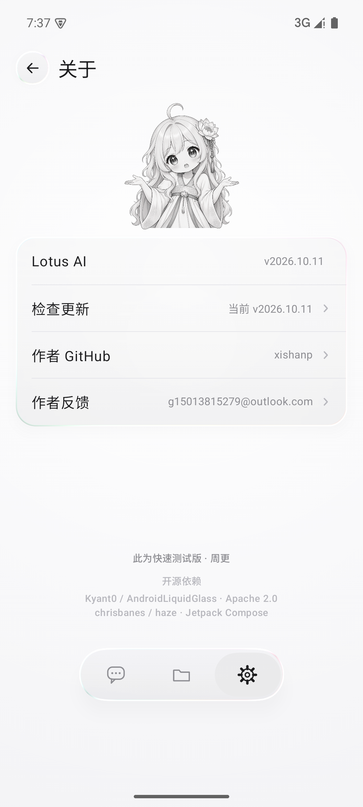

<p align="center">
  
</p>

<h1 align="center">Lotus AI</h1>

<h3 align="center">纯聊天 · 全局液态玻璃 · 有记忆的 Android AI 对话应用</h3>

<p align="center">
  <b>中文</b> · <a href="README.en.md">English</a>
</p>

<p align="center">
  
  
  
  
</p>

---

## 这是什么

**Lotus AI** 是一个安卓端的 AI 对话应用。它只做一件事：**聊天**。

界面从头到尾是一整套液态玻璃；对话本身轻、快、省 —— 一次提问就是一次模型调用，
请求里只有「人设 + 记忆 + 你说过的话」，没有别的东西拖慢它。

它记得住你，也有稳定的人格：记忆和人格都是**你可以直接打开、直接改的 Markdown 文件**。
模型可以自己往里写，你也可以随时替换成自己的。

## 它不是什么

- **不是 Agent。** 没有工具循环、没有后台任务、没有每轮塞进去的一大堆工具说明书。
  一次提问 = 一次请求，这就是它 token 消耗低、回答快的原因。
- **不预置任何厂商。** 接口地址、API Key、模型清单全部由你自己填，走 OpenAI 兼容协议。
- **不上传你的对话。** 没有账号体系、没有埋点，Key 和会话都只存在本机。

## 亮点

### 轻 · 省 token

- 请求体只包含三类内容：**人格提示词**、**记忆**、**对话历史**。没有工具描述、没有冗余包装。
- 长期记忆默认**分级注入**：三份必读（`IDENTITY` / `SOUL` / `AGENTS`）+ `MEMORY.md` 的
  「热指针」摘要段（硬上限 900 字）+ 按需检索。默认不把整个档案柜灌进每一轮。
- 上下文用量实时可见，可按会话**裁剪 / 压缩**；压缩只动摘要，原文一条不删。

### 快 · 流式回答，思考保留

- SSE 流式输出，边生成边显示。
- 思考档位**按模型的真实能力映射**：模型支持几档就给几档，从 `none` 一路到 `max` / `ultra`，
  不多不少；不支持就是灰的。

### 记得住 · 完整的 MD 记忆框架

- 人格与记忆是纯文本，在「文件」页里随时能改。
- **自动记忆**：模型把该长期记住的事写成一行隐藏标记，客户端在**同一次回答**里摘走并写进
  `MEMORY.md` —— 不产生第二次请求，也不额外烧 token。
- **手动记忆**：聊天页 `⋯ → 记住这段`，把当前会话压成几条长期记忆。
- **会话话题**：每个会话首轮答完自动生成一次标题。

### 像个人 · 可改写的人设

- 名字、语气、规则、边界都是 Markdown。改完立刻生效，不需要重装。
- 模型能**自己整理自己的记忆段**（只覆盖它自己写的那一段，你手写的内容原样在前）。

### 液态玻璃 · 一套统一的视觉语言

- 全部玻璃走同一套配方：**低模糊 + 边缘折射 + 色散 + 白色内高光 + 外柔影**，纯白底、零彩色。
- **同一块玻璃里不会再长出一块小玻璃**：嵌在里面的按键静止时隐形，按下去才浮出折射与放大。
- 每个按键都有真实反馈 —— 按压缩放、朝手指方向倾倒、相邻的玻璃轻轻联动。

### 对话本身该有的功能

- **长按消息** → 复制 / 引用 / 编辑重发 / 重新回答 / 撤回。
- **长按正文** → 选取 / 复制 / 全选（系统级文本选择）。
- 附件：图片 / 视频 / 文件；带视觉能力的模型能直接看图。
- 生图：配好生图服务后，直接说「画一张…」；出图期间有一块占位玻璃在动，图到了再从模糊收到清晰。
- 联网搜索：可选开关。打开后请求体里只多一条 `tools:[{"type":"web_search"}]`，搜索交给上游，
  客户端**仍然只有一次调用**。

## 截图

| 主页 | 聊天 |
| --- | --- |
|  |  |

| 文件（人格与记忆） | 关于 |
| --- | --- |
|  |  |

## 记忆与人格：一套可以直接改的 MD 文件

```
filesDir/md/
├── IDENTITY.md   我是谁        ← 每轮注入
├── SOUL.md       怎么说话       ← 每轮注入
├── AGENTS.md     规则与边界     ← 每轮注入
├── USER.md       关于你        ← 按需注入
├── MEMORY.md     长期记忆       ← 热指针每轮注入，其余按需
├── CAPABILITIES.md 能力边界（给人看，不注入）
└── memory/       档案柜（不注入，按需检索）
    facts · decisions · lessons · projects · references · tasks · temporary
```

三层读取策略（省 token 的关键）：

1. **必读**：`IDENTITY` / `SOUL` / `AGENTS` —— 人格和规则必须每轮都在。
2. **热指针**：`MEMORY.md` 顶部的摘要段，硬上限 900 字。
3. **按需**：`USER.md`、`MEMORY.md` 其余内容、`memory/` 档案柜。客户端先用你的原话做
   字符级匹配，模型需要更深的记忆时再写一个检索标记，把整柜翻开。

## 模型接入

- **协议**：OpenAI 兼容（`/chat/completions` 流式、`/models` 列表、`/images/generations` 生图）。
- **提供方**：可以配多个，每个提供方自己填地址、Key、模型列表，支持「测试连接」。
- **默认模型 / 对话设置**：模型、思考档位、是否显示用量、用户头像、是否显示每条耗时与 token 数。
- **外围能力**：联网搜索、生图、视频、OCR —— 都是**可选**的独立配置，不配就不占每轮 token。

## 技术栈

| 层 | 选型 |
| --- | --- |
| 语言 / UI | Kotlin 2.4.20 · Jetpack Compose（BOM 2026.09.00） |
| 构建 | AGP 9.4.1 · Gradle 9.7.1 · JDK 17 |
| 最低版本 | Android 8.0（API 28），`compileSdk 37` / `targetSdk 35` |
| 网络 / 序列化 | `HttpURLConnection` + SSE 手写解析 · kotlinx.serialization |
| 液态玻璃 | `io.github.kyant0:backdrop` + `io.github.kyant0:shapes` + `dev.chrisbanes.haze` |
| 存储 | 本机 JSON（提供方 / 会话）+ 纯文本 Markdown（人设与记忆） |

## 项目结构

```
app/src/main/java/ai/lotus/app/
├── MainActivity.kt              入口
├── data/                        纯数据层，不依赖 UI
│   ├── LlmApi.kt                OpenAI 兼容客户端（流式 SSE）
│   ├── Provider.kt              多提供方 / 模型清单 / 测试连接
│   ├── Conversation.kt          会话与消息模型
│   ├── Prompts.kt               提示词注入 · 分级记忆 · 自动记忆 · 检索
│   ├── ImageGen.kt              /images/generations
│   ├── Capabilities.kt          联网 / 生图 / 视频 / OCR 配置
│   ├── ThinkingTiers.kt         思考档位的真实映射
│   └── UpdateChecker.kt         GitHub Releases 版本检查
└── ui/
    ├── LotusApp.kt              外壳 / 路由 / 固定层
    ├── glass/                   ★ 玻璃基础设施（Glass.kt 是唯一配方来源）
    ├── home/                    首页 · 输入条 · 浮层菜单
    ├── chat/                    聊天页 · 气泡 · 生成占位动画
    ├── nav/                     底部导航（三格：对话 / 文件 / 设置）
    ├── settings/                设置页
    ├── md/                      MD 工作区（人格与记忆文件）
    └── model/                   模型目录
```

## 构建与运行

```bash
# 需要 JDK 17 与 Android SDK（compileSdk 37）
./gradlew :app:assembleDebug
adb install -r app/build/outputs/apk/debug/app-debug.apk
```

首次启动后：`设置 → 模型提供方 → 新增`，填 `Base URL`（到 `/v1` 为止）、`API Key`，
点「测试连接」拉到模型列表，再回首页选模型即可开聊。

## 版本与更新

- `设置 → 关于 → 检查更新`：查 GitHub Releases 的 `latest`，拿 tag 与本机版本比较；
  有新版本时给一个「去下载」按钮，直接打开发布页（App 内不会偷偷装 APK）。
- 发新版的方式：`app/build.gradle.kts` 的 `versionName`（如 `2026.10.18`）与 Release 的 tag
  （`v2026.10.18`）对齐即可，App 自动认得出。

## 素材

用到的绘图与设计稿都放在一个地方：

| 立绘 | 思考 | 读 MD |
| --- | --- | --- |
|  |  |  |

| 应用图标 | 首页设计稿 |
| --- | --- |
|  |  |

## 许可

本项目以 **Apache License 2.0** 开源，见 [LICENSE](LICENSE)。
第三方依赖与素材的许可见 [THIRD_PARTY_NOTICES.md](THIRD_PARTY_NOTICES.md)。

## 致谢

液态玻璃不是写一个 `blur()` 就能了事的。折射、色散、模糊这一整套，站在了这些上游之上：

| 项目 | 用途 | 许可 |
| --- | --- | --- |
| [Kyant0/AndroidLiquidGlass](https://github.com/Kyant0/AndroidLiquidGlass)（`io.github.kyant0:backdrop` / `shapes`） | 折射 / 色散 / 模糊 / 高光 / 阴影的底座 | Apache-2.0 |
| [chrisbanes/haze](https://github.com/chrisbanes/haze) | 模糊底座 | Apache-2.0 |

---

**每 7 天更新一版。**
